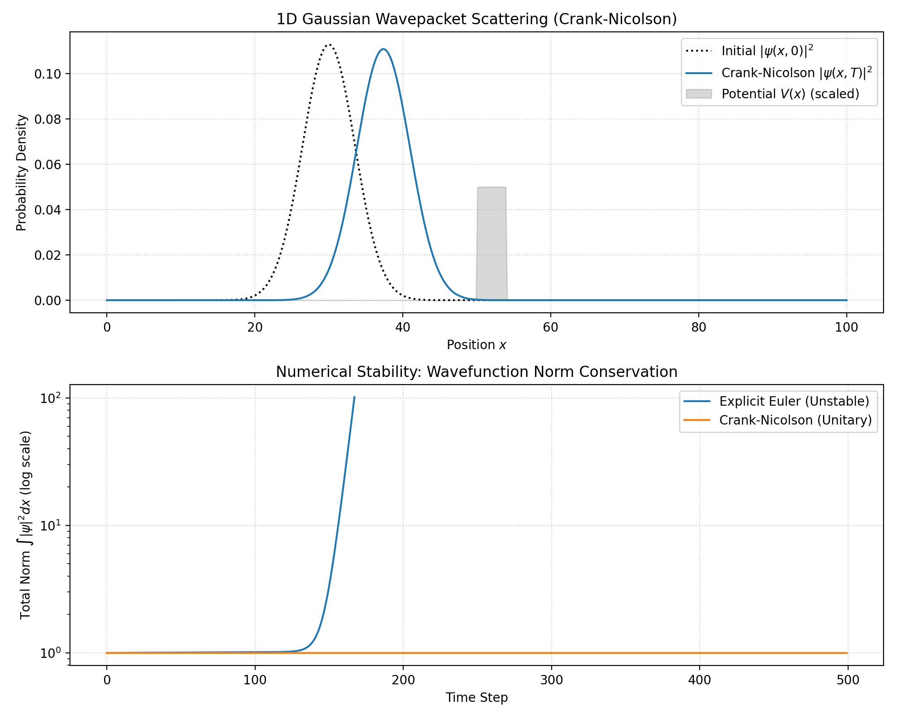
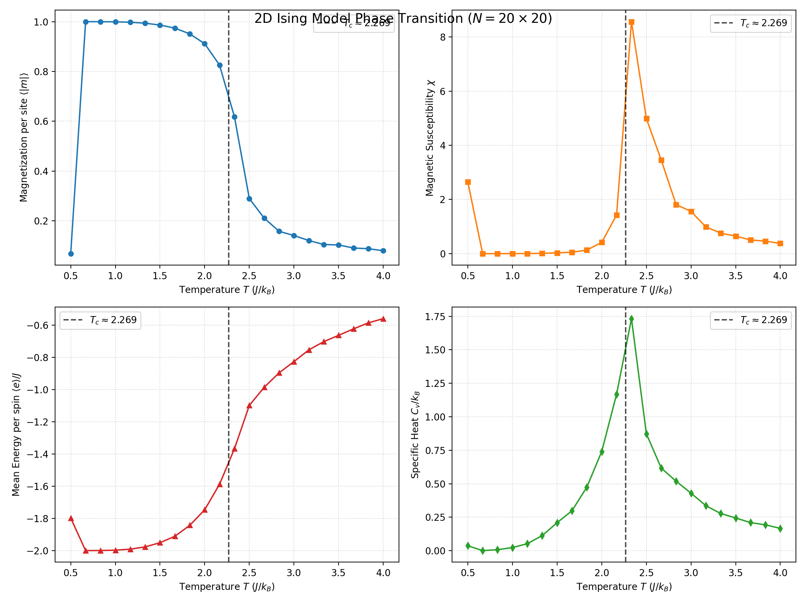
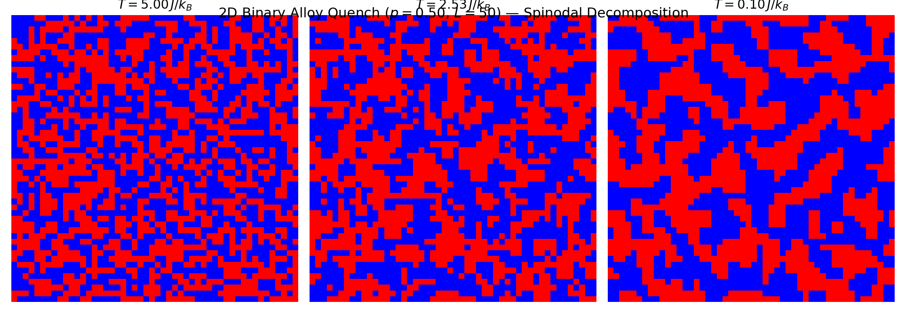
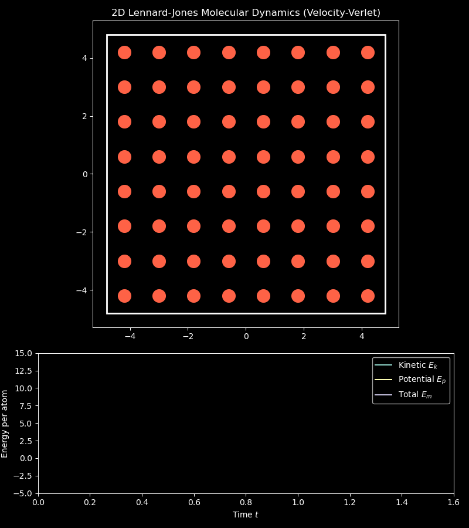
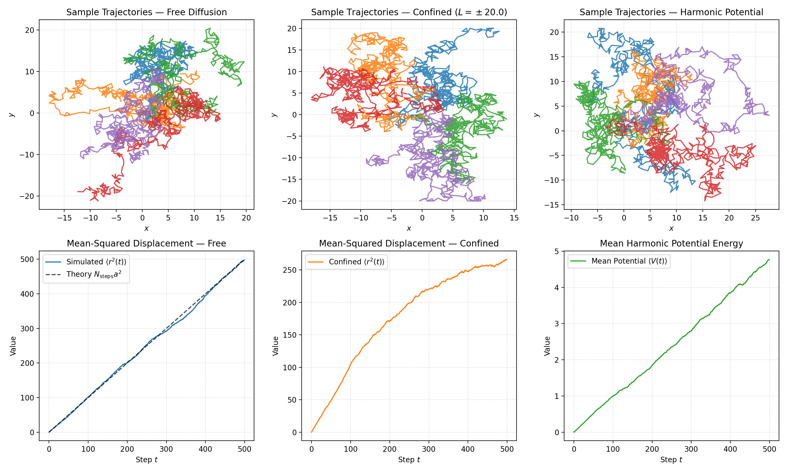
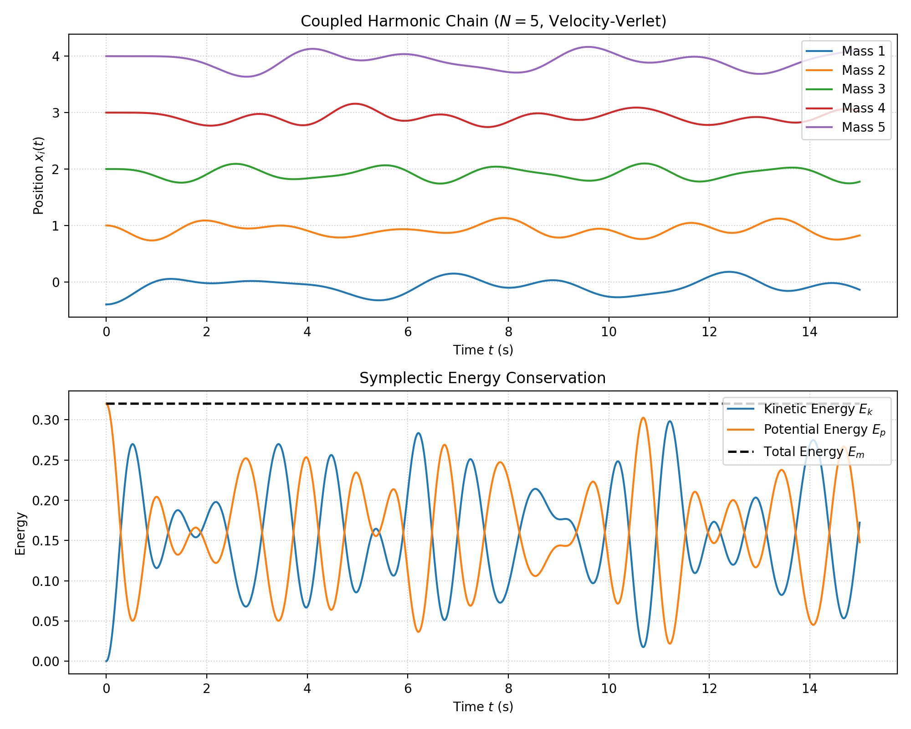
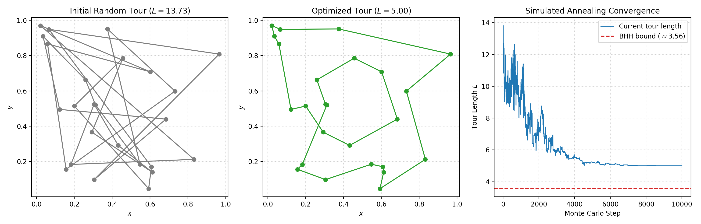

# Computational Physics & Numerical Simulations

A collection of self-contained Python numerical simulations spanning **quantum mechanics**, **statistical physics**, **molecular dynamics**, **stochastic processes**, **classical mechanics**, **cellular automata**, and **combinatorial optimization**.

---

## 📂 Repository Structure

```text
computational-physics-simulations/
├── quantum_mechanics/
│   └── schrodinger_1d.py               # 1D TDSE solver: Crank-Nicolson vs. Explicit Euler
├── statistical_physics/
│   ├── ising_2d.py                     # 2D Ising model phase transition (Metropolis MC)
│   └── binary_alloy_quenching.py       # 2D binary alloy spinodal decomposition & nucleation (Kawasaki MC)
├── molecular_dynamics/
│   └── lennard_jones_2d.py             # 2D Lennard-Jones fluid under gravity (Velocity-Verlet)
├── stochastic_processes/
│   └── random_walk_2d.py               # 2D Brownian diffusion: free, confined, and harmonic trap
├── classical_mechanics/
│   └── coupled_oscillators.py          # 1D coupled harmonic chain & energy conservation
├── automata_and_reversibility/
│   └── fssp_synchronization.py         # Firing Squad Synchronization Problem (1D cellular automata)
├── optimization/
│   └── tsp_simulated_annealing.py      # Traveling Salesman Problem via Simulated Annealing
├── figures/                            # Generated plots and animations
└── requirements.txt
```

---

## 🔬 Overview of Simulations

| Domain | Script | Physical Model & Numerical Method | Key Observables |
| :--- | :--- | :--- | :--- |
| **Quantum Mechanics** | `schrodinger_1d.py` | 1D Time-Dependent Schrödinger Equation ($i\hbar \partial_t \psi = \hat{H}\psi$) across a potential barrier; compares **Explicit Euler** vs. **Crank-Nicolson** tridiagonal solver | Wavepacket transmission/reflection, unitarity & norm conservation $\int \lvert \psi \rvert^2 \\, dx$
| **Statistical Physics** | `ising_2d.py` | 2D ferromagnetic Ising Hamiltonian $\mathcal{H} = -J \sum_{\langle i,j \rangle} S_i S_j$ with PBCs via **Metropolis Monte Carlo** | Magnetization $\langle m(T) \rangle$, susceptibility $\chi(T)$, energy $\langle E(T) \rangle$, specific heat $C_v(T)$ around $T_c \approx 2.269\,J/k_B$ |
| **Statistical Physics** | `binary_alloy_quenching.py` | Conserved-order-parameter 2D binary alloy ($A/B$) quenched from $T = 5.0$ to $0.1\,J/k_B$ via **Kawasaki spin-exchange** | Spinodal decomposition ($p = 0.50$) vs. nucleation and growth ($p = 0.10$) |
| **Molecular Dynamics** | `lennard_jones_2d.py` | $N = 64$ particles interacting via $V_{\mathrm{LJ}}(r) = 4\varepsilon [(\sigma/r)^{12} - (\sigma/r)^6]$ in a uniform gravitational field using **Velocity-Verlet** | Particle trajectories, kinetic/potential/mechanical energy balance |
| **Stochastic Processes** | `random_walk_2d.py` | Ensemble of $N = 1000$ 2D random walkers under free, reflective-box, and harmonic potential $V(x,y) = k(x^2+y^2)$ regimes | Mean-squared displacement $\langle r^2(t) \rangle$, spatial confinement, mean potential energy |
| **Classical Mechanics** | `coupled_oscillators.py` | 1D chain of $N$ Hookean coupled oscillators integrated with **Velocity-Verlet** | Normal-mode propagation and symplectic total energy conservation |
| **Cellular Automata** | `fssp_synchronization.py` | 1D Firing Squad Synchronization Problem (McCarthy–Minsky 15-state minimal-time algorithm) | Exact synchronization at step $2n - 2$ from local nearest-neighbor rules |
| **Optimization** | `tsp_simulated_annealing.py` | Euclidean Traveling Salesman Problem solved via **Simulated Annealing** with exponential cooling | Tour length convergence toward the Beardwood–Halton–Hammersley bound |

---

## 📊 Sample Results & Visualizations

### Quantum Dynamics & Statistical Mechanics
| 1D Schrödinger Wavepacket (Crank-Nicolson) | 2D Ising Phase Transition (T<sub>c</sub> ≈ 2.269) |
| :---: | :---: |
|  |  |

### Phase Separation & Molecular Dynamics
| Binary Alloy Quenching (p = 0.50) | 2D Lennard-Jones Fluid under Gravity |
| :---: | :---: |
|  |  |

### Stochastic Processes, Coupled Oscillators & Optimization
| 2D Brownian Diffusion Regimes | Coupled Harmonic Chain | TSP Simulated Annealing |
| :---: | :---: | :---: |
|  |  |  |

---

## 🚀 Quickstart

1. **Clone the repository:**
   ```bash
   git clone [https://github.com/s-elmir/computational-physics-simulations.git](https://github.com/s-elmir/computational-physics-simulations.git)
   cd computational-physics-simulations
   ```

2. **Install dependencies:**
   ```bash
   pip install -r requirements.txt
   ```

3. **Run any simulation** (plots are automatically saved to `figures/`):
   ```bash
   python quantum_mechanics/schrodinger_1d.py
   python statistical_physics/ising_2d.py
   ```
